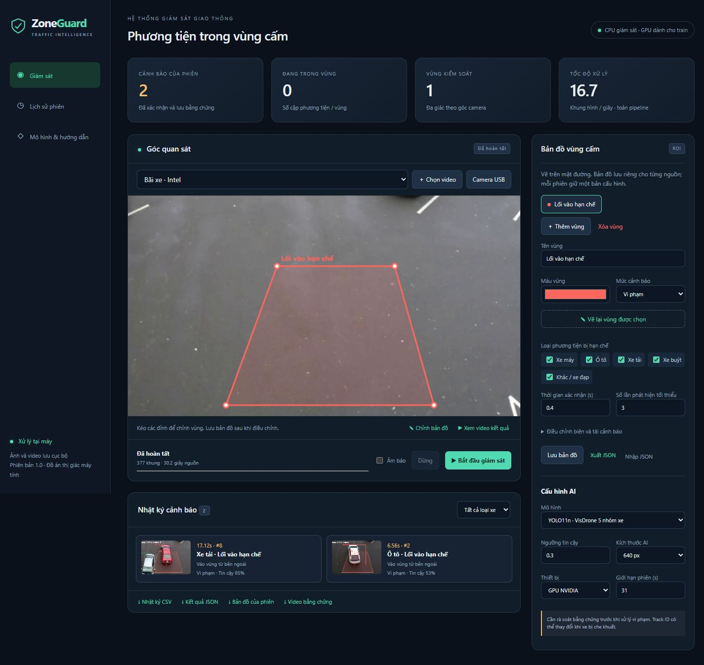

# Xây dựng hệ thống phát hiện phương tiện đi vào khu vực cấm

**ZoneGuard**: YOLO11 + ByteTrack, bản đồ đa giác trên camera, cảnh báo có ảnh bằng chứng và nhật ký SQLite. Phân tích video hoặc camera USB; giao diện tiếng Việt chạy tại máy.

Đề tài: **Xây dựng hệ thống phát hiện phương tiện đi vào khu vực cấm**. Sản phẩm gồm checkpoint AI dùng được ngay, trình vẽ vùng cấm theo góc camera và cảnh báo kèm bằng chứng. Mã nguồn được lưu theo từng phần tại [GitHub](https://github.com/JunnDung/restricted-zone-vehicle-detection).



## Chạy tại Windows

Máy hiện tại đã có môi trường CUDA tại `.venv`. Nhấp `run.cmd`, mở **http://127.0.0.1:8003**. Server dùng một nguồn và một tiến trình; giữ cửa sổ server khi sử dụng.

Trên máy mới cần Python 3.12, internet khi cài dependency, sau đó chạy PowerShell tại thư mục dự án:

```powershell
powershell -ExecutionPolicy Bypass -File setup.ps1 -Cuda
.\run.cmd
```

Bỏ `-Cuda` nếu dùng CPU. Có thể truyền `-Python C:\duong-dan\python.exe`. Setup tạo venv riêng, cài torch/torchvision từ kho chính thức, cài các phiên bản khóa và chạy kiểm thử. Trọng số và hai video mẫu đã nằm trong repository; chạy demo không cần tải dataset hoặc tài khoản cloud. Không chạy hai server cùng trỏ một thư mục runtime.

## Sử dụng

1. Chọn **Bãi xe · Intel**, video khác hoặc Camera USB (chỉ số 0–5). Video tối đa 500 MB, 15 phút, 54.000 khung và 4096 px mỗi chiều/9 megapixel.
2. Kiểm tra đa giác trên mặt đường. **Thêm vùng**, click đỉnh theo thứ tự, Enter/Hoàn tất để kết thúc; kéo đỉnh để chỉnh; Escape để hủy. Tối đa 10 vùng, 3–32 đỉnh/vùng. Có thể nhập/xuất JSON.
3. Chọn loại xe bị hạn chế, thời gian xác nhận, số lần phát hiện, vùng đệm biên và thời gian xác nhận ra ngoài. **Lưu bản đồ** lưu riêng cho nguồn đang chọn.
4. Bấm **Bắt đầu giám sát**; chọn Âm báo để bật tiếng cảnh báo trong trình duyệt. Mở ảnh cảnh báo để rà soát; sau phiên, **Xem diễn biến trước cảnh báo** mở video từ hai giây trước khung đó.
5. Sau phiên tải CSV UTF-8, JSON, cấu hình và video MP4/H.264. Lịch sử và ảnh còn lại sau khi khởi động lại; cấu hình phiên là bản chụp độc lập với bản đồ sửa sau đó.

Một cảnh báo cho mỗi cặp track/vùng/lượt. Xe phải xuất hiện liên tục đủ dwell và min_frames với detection đạt ngưỡng tin cậy; detection yếu vẫn được nối track nhưng đặt lại chuỗi chưa xác nhận. Mất quan sát hơn 1 giây không được cộng nối thời gian. Ra ngoài đủ exit_seconds mới cho cảnh báo lượt tiếp theo. Tùy chọn “Cảnh báo xe đã có…” tắt thì cần quan sát xe ở ngoài trước khi vào. Điểm giữa cạnh đáy bounding box xấp xỉ vị trí xe chạm đường; không xét đơn thuần góc hộp bao giao đa giác.

Khi GPU đang train, **Tự động** dùng CPU cho giám sát; chọn GPU trực tiếp bị chặn để tránh hết VRAM. Có thể giảm kích thước AI/độ phân giải nguồn nếu CPU chậm. Bản đồ là ROI trong ảnh, chưa có tọa độ GIS; hệ thống cảnh báo cục bộ bằng giao diện/âm báo/nhật ký, không gửi email hay webhook.

## Fine-tune nhanh tại máy, không mất phí cloud

Run YOLO11s lớn đã lỗi RAM trong epoch 1, chưa hoàn thành epoch. Cấu hình hiện tại dùng **YOLO11n 5 lớp đã học phương tiện**, fine-tune tối đa **15 epoch**, batch **4**, 640 px, AMP, không Mosaic/cache ảnh. Bộ mới chọn tối đa **12.000 ảnh train** từ COCO vehicles + MIO camera + VisDrone; có validation/test riêng theo ba nguồn và loại trùng chính xác. Số lượng thực tế, lớp nhãn và checksum ở `reports/compact-dataset.json`.

```powershell
# Dataset hiện tại: kiểm lại toàn bộ ảnh/nhãn theo manifest.
.\.venv\Scripts\python.exe scripts\prepare_compact.py
# Chạy GPU ở nền; tự đánh giá và commit/push kết quả cuối.
powershell -ExecutionPolicy Bypass -File start-training.ps1
# Chỉ resume sau khi đã có runs/zoneguard_compact/weights/last.pt.
powershell -ExecutionPolicy Bypass -File start-training.ps1 -Resume
```

Trên máy mới, `prepare_visdrone.py` → `prepare_large.py` → `prepare_compact.py` tái tạo các nguồn và bước chọn mẫu. Khi compact đã được kiểm thành công, bộ lớn/raw trung gian không cần cho training. Nhật ký dọn dữ liệu ở `reports/data-cleanup.json`; video demo, model và lịch sử sử dụng được giữ.

Theo dõi **Mô hình & hướng dẫn** trong dashboard, `reports/training-live.json`, `runtime/training.stdout.log` và `runtime/training.stderr.log`. Có số ảnh đã kiểm, batch đánh giá baseline và epoch/batch train; cập nhật khoảng 15 giây. Khi Windows còn dưới 2 GB RAM hoặc khả năng commit, training chờ. Khởi động GPU yêu cầu 2,5 GB VRAM trống. Các ứng dụng khác không bị đóng. `last.pt` được lưu mỗi epoch; chưa có checkpoint thì không thể resume batch giữa epoch. Giữ máy hoạt động, tránh Sleep.

Model mới chỉ xuất hiện sau khi trung bình validation mAP50–95 tăng >0,005, không nguồn nào giảm quá 0,02 và F1 cảnh báo không giảm trên video hiệu chỉnh. Chưa khẳng định tăng độ chính xác hoặc tốc độ thực tế trước báo cáo cuối. COCO pretrained từng dùng dữ liệu COCO; split MIO chưa xác nhận độc lập camera. Chi tiết lựa chọn, nguồn và giới hạn: [TRAIN_NHANH](docs/TRAIN_NHANH.md), [MODEL_CARD](models/MODEL_CARD.md).

Dataset/venv/log/runtime không đẩy GitHub. Repository giữ script, manifest hash, báo cáo và checkpoint demo; launcher dùng `--backup-github` để lưu kết quả cuối. Git dùng Credential Manager hiện có. Nếu push lỗi, kết quả vẫn ở máy; chạy `git push` sau khi kết nối lại.

## Kết quả đã kiểm chứng

| Kiểm tra | Kết quả |
|---|---|
| Quy tắc vùng, validation API, lưu lịch sử, lớp nhãn, chống tranh GPU, ảnh preview, khóa tệp Windows, hash và độ tin cậy xác nhận | 23 kiểm thử unittest đạt |
| Checkpoint nguồn VisDrone 5 lớp, test-dev sau chuyển đổi | mAP50 37,54%; mAP50–95 22,24% |
| Video bãi xe Intel, 377 khung, cấu hình mặc định | Hai cảnh báo tại 6,56 s và 17,12 s |
| Phân loại hai cảnh báo | Xe trắng đúng car; xe đỏ bị nhầm truck |
| YOLO11n/YOLO11s COCO trên cùng video | 0 cảnh báo |
| Dashboard | Vẽ ROI, lịch sử, ảnh bằng chứng, phát MP4/H.264, bố cục desktop/mobile được kiểm tra trong trình duyệt |

Nguồn số đo: `reports/upstream-training.json`, `reports/model-comparison.json`, `reports/parking-reference.json`, `reports/system-validation.json` (snapshot kiểm tra ban đầu) và `reports/research-improvements.json` (đợt cải tiến sau tra cứu). Mốc video được gán tay với cửa sổ thời gian, chỉ gồm hai lượt và đã dùng hiệu chỉnh; F1 trên đó không thể suy rộng thành độ chính xác thực địa. FPS ban đầu có tiến trình dashboard chạy đồng thời nên chỉ tham khảo, chưa phải benchmark phần cứng có kiểm soát. Mô hình train lớn chưa được coi là cải thiện cho đến khi có báo cáo cuối và `accepted: true`.

Camera USB có đường chạy và thông báo lỗi thiết bị, chưa được kiểm chứng bằng camera vật lý trong đợt bàn giao này. Ban đêm, camera rung, xe bị che và ID đổi vẫn là hạn chế. Không có nhận diện biển số, nhiều camera đồng thời hoặc RTSP trong phiên bản này.

## Chạy không qua dashboard và kiểm thử

```powershell
.\.venv\Scripts\python.exe pipeline.py data\samples\car-detection.mp4 --zones config\parking.json --output runtime\cli-demo --device 0
.\.venv\Scripts\python.exe pipeline.py camera:0 --output runtime\camera-demo --device cpu --max-seconds 60
.\.venv\Scripts\python.exe -m unittest discover -s tests -v
```

Mỗi lần CLI cần output mới để không ghi đè phiên cũ. API docs ở http://127.0.0.1:8003/docs. Server mặc định chỉ bind 127.0.0.1; chưa có đăng nhập cho triển khai ra mạng.

## Cấu trúc

| Đường dẫn | Vai trò |
|---|---|
| app.py / web/ | API và giao diện tiếng Việt |
| pipeline.py / zones.py / store.py | Detector/tracker, quy tắc lượt vào vùng, SQLite |
| config/parking.json | Bản đồ mẫu ROI và chính sách |
| models/ | Checkpoint hiện tại, COCO khởi tạo và model card |
| scripts/ | Chuẩn bị dữ liệu, train, đánh giá cảnh báo |
| reports/ | Nguồn gốc và số đo tái kiểm tra |
| runtime/ | Video tải lên, bản đồ từng nguồn, phiên, bằng chứng, log (không commit) |
| datasets/compact/ / runs/zoneguard_compact/ | Dataset hiện tại và checkpoint training (không commit) |
| docs/BAO_CAO.md | Mô tả phương pháp và kế hoạch đánh giá thực địa |
| docs/THAM_KHAO_CAI_TIEN.md | Đối chiếu nghiên cứu và kiểm chứng ban đầu |
| docs/TRAIN_NHANH.md | Cấu hình hiện tại, lựa chọn dataset và xử lý bộ nhớ |

## Tham khảo và ghi công

- [Ultralytics YOLO11](https://docs.ultralytics.com/models/yolo11/) và [tracking](https://docs.ultralytics.com/modes/track/): detector/tracker và pretrained COCO, AGPL-3.0.
- [ByteTrack — FoundationVision](https://github.com/FoundationVision/ByteTrack): theo dõi kết hợp detection điểm tin cậy thấp.
- [OpenCV pointPolygonTest](https://docs.opencv.org/4.x/dc/d48/tutorial_point_polygon_test.html): khoảng cách có dấu tới biên đa giác.
- [VisDrone Dataset](https://github.com/VisDrone/VisDrone-Dataset): drone detector, giữ các split gốc. `prepare_visdrone.py` và checkpoint 5 lớp tái sử dụng từ dự án cùng máy nêu trong model card.
- [MIO-TCD — tác giả](https://tcd.miovision.com/challenge/dataset.html): Luo và cộng sự, dữ liệu camera giao thông, CC BY-NC-SA 4.0.
- [Intel sample videos](https://github.com/intel-iot-devkit/sample-videos): CC BY 4.0; attribution và URL/hash từng video trong `data/samples/NOTICE.md` và `sources.json`.

Mã nguồn dự án: AGPL-3.0, xem LICENSE. Điều khoản dataset và mẫu video được giữ riêng theo nguồn; xem model card trước khi sử dụng trọng số kết hợp ngoài phạm vi nghiên cứu.
