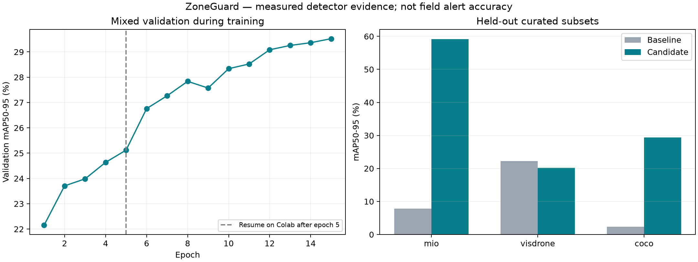

# ZoneGuard

[](https://github.com/JunnDung/restricted-zone-vehicle-detection/actions/workflows/checks.yml)
[](LICENSE)

**Hệ thống phát hiện phương tiện đi vào khu vực cấm** từ video hoặc camera USB. Dự án cá nhân kết hợp YOLO11, ByteTrack và bản đồ vùng đa giác để ghi nhận vi phạm, lưu bằng chứng và xem lại trên dashboard tiếng Việt.


## Tính năng

- Phát hiện xe máy, ô tô, xe tải, xe buýt và nhóm phương tiện khác.
- Theo dõi phương tiện bằng ByteTrack; dùng điểm giữa cạnh dưới bounding box để kiểm tra vùng cấm.
- Vẽ và chỉnh sửa vùng đa giác theo góc nhìn camera; cấu hình loại xe, thời gian xác nhận và quy tắc cảnh báo.
- Tổng hợp nhãn qua nhiều khung hình để giảm thay đổi loại xe; hiển thị nhóm chung khi chưa đủ bằng chứng phân loại.
- Lưu ảnh bằng chứng, thời điểm vào vùng, track ID và nhật ký SQLite; xem video kết quả và xuất CSV/JSON.
- Chạy suy luận trên CPU hoặc GPU NVIDIA; cung cấp dashboard và REST API qua FastAPI.

## Cài đặt và chạy

Yêu cầu: **Windows, Python 3.12, Git**. GPU NVIDIA cần driver tương thích PyTorch CUDA 12.8; có thể dùng CPU nếu không có GPU.

```powershell
git clone https://github.com/JunnDung/restricted-zone-vehicle-detection.git
cd restricted-zone-vehicle-detection
powershell -ExecutionPolicy Bypass -File setup.ps1 -Cuda
.\run.cmd
```

Mở **http://127.0.0.1:8003**. Để cài bản CPU, bỏ `-Cuda`. Script tạo môi trường `.venv`, cài dependency và chạy kiểm thử. Có thể chỉ định Python bằng `setup.ps1 -Python C:\Python312\python.exe`.

1. Chọn video mẫu, tải video lên hoặc chọn camera USB.
2. Vẽ vùng cấm trên ảnh xem trước và lưu bản đồ.
3. Chọn mô hình, thiết bị và quy tắc xác nhận rồi bắt đầu phân tích.
4. Mở cảnh báo để xem bằng chứng, diễn biến trước cảnh báo hoặc xuất kết quả.

Dữ liệu phiên chạy được lưu trong `runtime/` và không đưa vào Git. Bản đồ là vùng trên ảnh camera, không phải bản đồ địa lý; cần vẽ lại khi camera đổi vị trí.

## Mô hình và kết quả

Checkpoint mặc định trên dashboard là **YOLO11n**, fine-tune 15 epoch trên **12.000 ảnh train**, với **1.500 ảnh validation** và **1.500 ảnh test** từ MIO-TCD, VisDrone và COCO. Model có **2.590.815 tham số**, trọng số suy luận **5,23 MiB**.

| mAP50–95 trên test chọn lọc | Baseline | Fine-tuned |
|---|---:|---:|
| MIO-TCD | 7,80% | 59,16% |
| VisDrone | 22,22% | 20,14% |
| COCO vehicles | 2,31% | 29,34% |
| Trung bình đều ba nguồn | 10,78% | **36,21%** |

Trung bình tăng **25,44 điểm phần trăm**, nhưng VisDrone giảm **2,08 điểm phần trăm**. Đây là các split chọn lọc, không phải benchmark đầy đủ của các dataset. Quyết định chọn checkpoint dựa trên validation trước khi đánh giá test.



Video hồi quy bãi xe gồm 377 khung hình và hai lượt xe: F1 có xét loại xe tăng từ 0,50 lên 1,00; pipeline đạt 28,10 FPS trên Tesla T4, tính cả xuất H.264 trong một lần chạy. Phép đo này thực hiện trước khi bổ sung chính sách tổng hợp nhãn hiện tại. Hai lượt xe không đủ để suy ra độ chính xác ngoài thực địa.

- [Phương pháp đánh giá và giới hạn](docs/EVALUATION.md)
- [Model card, nguồn trọng số và giấy phép](models/MODEL_CARD.md)
- [Kết quả chi tiết theo lớp và nguồn](reports/compact-training.json)
- [Video kết quả](reports/demo-colab-model.mp4)

## Huấn luyện

[Notebook Google Colab](notebooks/ZoneGuard_Colab.ipynb) hỗ trợ GPU T4 và khôi phục checkpoint có optimizer. Xem [hướng dẫn Colab](docs/COLAB.md) để đóng gói, tái tạo dữ liệu và tải checkpoint về máy.

```powershell
.\.venv\Scripts\python.exe scripts/package_colab.py
```

Để tái tạo dataset và bắt đầu một lần fine-tune cục bộ:

```powershell
.\.venv\Scripts\python.exe scripts/restore_compact.py
powershell -ExecutionPolicy Bypass -File start-training.ps1
```

Cấu hình cục bộ dùng batch 4, ảnh 640 px, AMP, SGD và tối đa 15 epoch. Chỉ dùng `start-training.ps1 -Resume` khi đã có checkpoint huấn luyện trong `runs/zoneguard_compact/`. Trọng số inference đã bỏ optimizer không dùng để resume. Dữ liệu được tải từ nguồn gốc; manifest và SHA-256 giúp kiểm tra tính nhất quán.

## Cấu trúc

| Thành phần | Vai trò |
|---|---|
| `app.py`, `web/` | REST API và dashboard |
| `pipeline.py`, `classification.py` | Phát hiện, tracking và tổng hợp nhãn |
| `zones.py`, `config/` | Bản đồ vùng và quy tắc cảnh báo |
| `store.py` | Nhật ký và bằng chứng |
| `models/` | Trọng số, model card và checkpoint phục hồi |
| `scripts/`, `notebooks/` | Chuẩn bị dữ liệu, train, đánh giá và Colab |
| `reports/` | Kết quả đánh giá, provenance và hình minh họa |
| `tests/` | Kiểm thử API, dữ liệu, phân loại và quy tắc vùng |

## Kiểm thử và đóng góp

```powershell
.\.venv\Scripts\python.exe -m unittest discover -s tests -v
```

GitHub Actions chạy kiểm thử trên mỗi push và pull request. Bạn có thể mở issue kèm bước tái hiện, cấu hình model và ảnh/video được phép chia sẻ. Pull request nên tập trung vào một thay đổi và bổ sung kiểm thử khi thay đổi logic.

## Giới hạn

Xe nhỏ, bị che, cảnh đêm hoặc góc nhìn khác dữ liệu train có thể làm sai nhãn và mất track. Chính sách tổng hợp nhãn giảm việc đổi loại xe nhưng có thể trả về nhóm chung khi chưa chắc chắn. Cần đánh giá bằng video có nhãn từ camera triển khai trước khi sử dụng cho quyết định thực tế.

COCO/VisDrone từng được sử dụng trong phát triển model gốc; split MIO chưa được chứng minh độc lập camera. Các số đo hiện có không chứng minh khả năng tổng quát trên mọi camera.

## Giấy phép và nguồn

Mã nguồn theo [AGPL-3.0](LICENSE); Ultralytics cũng sử dụng AGPL-3.0. Giấy phép mã nguồn không thay thế điều khoản của dataset và trọng số: MIO-TCD có điều khoản **CC BY-NC-SA 4.0**, VisDrone và ảnh COCO theo nguồn tương ứng. Xem [model card](models/MODEL_CARD.md), [provenance dữ liệu](reports/compact-dataset.json) và [ghi nhận video mẫu](data/samples/NOTICE.md) trước khi tái sử dụng.

Dựa trên [Ultralytics YOLO](https://github.com/ultralytics/ultralytics), [ByteTrack](https://github.com/ifzhang/ByteTrack), [MIO-TCD](https://tcd.miovision.com/challenge/dataset.html), [VisDrone](https://github.com/VisDrone/VisDrone-Dataset) và [COCO](https://cocodataset.org/).
