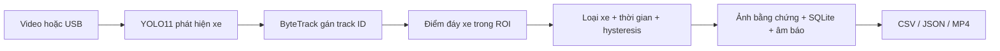

# Xây dựng hệ thống phát hiện phương tiện đi vào khu vực cấm

## Mục tiêu và sản phẩm

Phân tích hình ảnh từ camera cố định để xác định phương tiện đi vào vùng hạn chế/tuyến đường được kiểm soát. Người dùng xác định vùng trong ảnh và các loại phương tiện bị cấm; hệ thống lưu cảnh báo có thể rà soát. Ba sản phẩm: mô hình AI, bản đồ ROI chỉnh được và dashboard cảnh báo/lịch sử. Phạm vi hiện tại: một video hoặc camera USB mỗi phiên, xử lý tại máy Windows.

## Phương pháp

YOLO tạo hộp bao/lớp/điểm tin cậy mỗi khung. ByteTrack duy trì định danh, dùng cả detection điểm thấp để nối xe tạm bị che. Chỉ detection đủ ngưỡng người dùng được tích lũy để xác nhận vi phạm; detection yếu đặt lại chuỗi chưa xác nhận. Mỗi phiên tạo model và tracker riêng để không mang track từ camera trước. Nhãn một track được ổn định bằng tổng phiếu tin cậy; nhãn ổn định vẫn có thể sai nếu detector liên tục nhầm.

Điểm xét vùng là giữa cạnh đáy hộp bao, chuẩn hóa theo kích thước ảnh. OpenCV trả khoảng cách có dấu từ điểm tới đa giác; khoảng đệm tách ngưỡng vào/ra làm giảm rung ở biên. Xác nhận khi đồng thời đạt thời gian dwell và số quan sát min_frames. Mất detection quá một giây đặt lại chuỗi xác nhận. Sau cảnh báo phải ra ngoài đủ thời gian mới tái cảnh báo; đổi lớp xe khi đang ở trong không được mở lượt mới. Các vùng được xử lý độc lập, nên một xe có thể vi phạm hai vùng.

Video sử dụng khung/FPS làm thời gian; camera dùng đồng hồ monotonic. Việc xử lý video nhanh/chậm hơn tốc độ phát không làm thay đổi mốc cảnh báo. Video camera xuất theo FPS danh định nên thời lượng phát lại có thể khác thời gian thực khi pipeline chậm.

## Dữ liệu và thí nghiệm

Checkpoint ban đầu từ VisDrone DET đã fine-tune 30 epoch trên RTX 3060 Laptop. Kết quả test-dev sau chuyển đổi 5 lớp: mAP50 0,3754; mAP50–95 0,2224. Mô hình này dùng được ngay, nhưng recall thấp và domain drone khác camera giao thông.

Trong video bãi xe Intel, đa giác mẫu tạo hai cảnh báo xác nhận ở 6,56 s và 17,12 s. Xe thứ hai là ô tô đỏ nhưng model gán truck; COCO pretrained YOLO11n và YOLO11s không tạo cảnh báo. Đây là bằng chứng cần dữ liệu sát góc camera, không chỉ tăng số tham số.

Pipeline mới dùng phần có nhãn thật của MIO-TCD Localization, kết hợp VisDrone giữ tính đa góc nhìn. Nhãn ground truth gốc được đọc, hộp MIO tọa độ inclusive được chuyển sang YOLO và clipping đúng kích thước ảnh. Nhóm motorized_vehicle không phân biệt loại được che, pedestrian làm background. Ghi SHA-256 ảnh/nhãn, nguồn tải, chính sách split và phân bố lớp để phát hiện dữ liệu thay đổi.

MIO chia bằng hash nhóm ID liền kề 1.000 ảnh để hạn chế đưa ảnh cạnh nhau sang các split khác; chưa có metadata camera xác nhận độc lập. Loại ảnh trùng hệt bằng hash trước khi lập danh sách train/validation/test, ưu tiên giữ ảnh ở test rồi validation. Near duplicate chưa được loại. Checkpoint được chọn với validation cân bằng hai nguồn; đo toàn bộ validation riêng từng nguồn, rồi test giữ lại. Không dùng các tệp demo prediction của tác giả làm nhãn train.

Các báo cáo máy đọc được nằm trong `reports/`: upstream-training, upstream-dataset, model-comparison, parking-reference, large-dataset, large-baseline-validation, large-training khi tương ứng hoàn tất. Không điền số đo train mới khi chưa thực sự chạy xong. Điều kiện đưa model mới vào sử dụng: trung bình validation mAP50–95 tăng >0,005, VisDrone giảm không quá 0,02, F1 cảnh báo có/không xét loại xe đều không giảm trên video hiệu chỉnh.

## Cải tiến đã triển khai

| Vấn đề | Cách xử lý | Giới hạn còn lại |
|---|---|---|
| Cảnh báo nhiều lần mỗi khung | Trạng thái theo track/vùng/lượt, xác nhận thời gian | Track đổi sau che khuất vẫn có thể lặp |
| Dao động ở biên vùng | Khoảng đệm có dấu và thời gian xác nhận ra ngoài | Cần hiệu chỉnh theo phối cảnh |
| Nhãn thay đổi làm mở lượt mới | Tách trạng thái hình học và loại xe; phiếu nhãn theo track | Sai ổn định không tự sửa được |
| Đổi nguồn mang theo tracker/bản đồ | Tracker mới và map riêng từng source, snapshot từng phiên | Người dùng phải vẽ lại khi camera dịch chuyển |
| Dữ liệu/nhãn thiếu nguồn gốc | Hash, mapping rõ, split có manifest, baseline đối chứng | Split MIO chưa chứng minh camera độc lập |
| GPU laptop bị chia sẻ quá mức | Một phiên giám sát, CPU khi GPU train, AMP batch 8 | CPU có thể không đạt thời gian thực |
| Mất lịch sử khi restart | SQLite WAL và phục hồi phiên bị gián đoạn | Chỉ lưu tại một máy; chưa có HA/backup runtime tự động |
| Khó rà soát kết quả | Ảnh bằng chứng, nút xem video từ hai giây trước cảnh báo, overlay MP4/H.264, CSV/JSON | Chưa có video clip riêng quanh từng cảnh báo |
| Không biết train đang làm gì | Số ảnh xác minh, batch baseline và epoch/batch train, cập nhật khoảng 15 giây | Chưa có ETA đáng tin trước epoch đầu |

Chi tiết đối chiếu nguồn nghiên cứu, lựa chọn cải tiến và kết quả kiểm chứng nằm trong [Tham khảo và cải tiến](THAM_KHAO_CAI_TIEN.md).

## Đánh giá trên camera triển khai

Cần video có nhãn theo lượt, chia theo camera/ngày thay vì chia ngẫu nhiên từng khung. Bộ test cần xe không vi phạm, xe đã ở trong lúc bắt đầu, đi sát biên, vào/ra lại, che khuất, góc nhìn xa, ngày/đêm và đủ lớp xe. Giữ test độc lập với video dùng chỉnh ROI/ngưỡng.

Đo detector mAP50–95 theo lớp; đo lượt vi phạm precision/recall/F1 với ghép một-một, đúng vùng và cửa sổ thời gian; đo sai loại xe, cảnh báo lặp, lượt bỏ sót, độ trễ xác nhận. Đo FPS toàn pipeline, RAM/VRAM và CPU/GPU khi không có tác vụ cạnh tranh. Quy định ngưỡng chấp nhận trước khi nhìn test. Hai lượt trong video mẫu hiện tại chỉ là bài kiểm tra hồi quy, chưa đủ làm kết luận triển khai.

## Bàn giao và giới hạn

README có lệnh cài/chạy/resume; model card có provenance, metrics và giấy phép. GitHub lưu các commit theo chức năng và chạy unittest bằng GitHub Actions. Video nguồn/weights demo được lưu, dataset lớn/venv/runtime loại khỏi Git. Script training có tùy chọn tự commit/push kết quả khi hoàn tất; máy phải tiếp tục chạy và kết nối GitHub cho bước push.

Camera USB chưa được xác nhận bằng thiết bị vật lý trong đợt này. Không có GIS, RTSP, nhận diện biển số, email, đa camera hay xác thực server qua mạng. Cảnh báo cần được người vận hành rà soát trước quyết định xử lý. Hướng phát triển ưu tiên sau khi có dữ liệu thực địa: fine-tune theo camera, bổ sung cảnh đêm/che khuất và hiệu chỉnh phép chiếu mặt đường; chỉ thêm các tích hợp vận hành khi có yêu cầu cụ thể.

## Tham khảo

[Ultralytics YOLO11](https://docs.ultralytics.com/models/yolo11/), [Ultralytics Tracking](https://docs.ultralytics.com/modes/track/), [ByteTrack](https://github.com/FoundationVision/ByteTrack), [OpenCV Polygon Test](https://docs.opencv.org/4.x/dc/d48/tutorial_point_polygon_test.html), [VisDrone](https://github.com/VisDrone/VisDrone-Dataset), [MIO-TCD](https://tcd.miovision.com/challenge/dataset.html), [Intel sample-videos](https://github.com/intel-iot-devkit/sample-videos).
