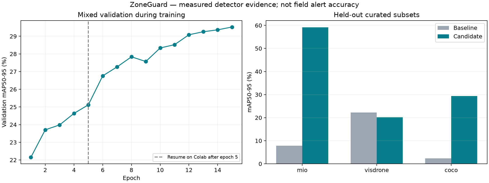

# ZoneGuard — engineering case study

Vehicle intrusion detection for fixed cameras: YOLO11n → ByteTrack → polygon/dwell rules → evidence and persistent alerts.

## Measured detector results

| Held-out subset | Baseline mAP50–95 | Candidate mAP50–95 | Change |
|---|---:|---:|---:|
| mio | 7.80% | 59.16% | +51.36 pp |
| visdrone | 22.22% | 20.14% | -2.08 pp |
| coco | 2.31% | 29.34% | +27.03 pp |
| Equal-source mean | 10.78% | 36.21% | +25.44 pp |

Deployment gate: **passed; candidate available in the dashboard**. Checkpoint selection and promotion were decided using validation and the calibration video before inspecting test scores.

Model: 2,590,815 parameters; 5.23 MiB inference checkpoint. Evaluation device: Tesla T4; image size 640; validation/test batch 16.

| Parking-video regression | Baseline | Candidate |
|---|---:|---:|
| Class-aware event F1 | 0.50 | 1.00 |
| Alert-only event F1 | 1.00 | 1.00 |
| Pipeline FPS, including video encoding | 27.93 | 28.10 |

The video contains only two reviewed events and was used for calibration. Its F1 is a regression result, not field accuracy. FPS is one full-video run per model on the stated device, not a cross-machine comparison.

## What the implementation demonstrates

- Five-class data conversion, ignored-region masking, deterministic sampling, exact-duplicate removal and SHA-256 provenance across 15,000 images (12,000/1,500/1,500 train/val/test).
- Cross-platform recovery of the original dataset and optimizer checkpoint; Colab T4 training resumes after five completed laptop epochs.
- Equal-source validation checkpoint selection with per-domain regression limits; both old and candidate models evaluated on held-out subsets.
- One alert per track/zone/entry, boundary hysteresis, class stabilization, evidence images, H.264 video, SQLite history, CSV/JSON exports and API/rule tests in CI.

## CV wording (English)

- Built an end-to-end vehicle intrusion monitoring system with YOLO11n, ByteTrack, editable polygon zones, FastAPI and SQLite, including evidence capture and video/CSV exports.
- Curated a checksum-verified 15,000-image traffic dataset; improved equal-source held-out detector mAP50–95 from 10.8% to 36.2% (+25.4 percentage points) on the selected MIO/VisDrone/COCO subsets.
- Implemented resumable Colab training, per-domain model admission gates and automated API/rule regression checks with GitHub Actions.

## Limits and reproducibility

Curated, class-covered subset; not official dataset benchmark. COCO val halves were not fine-tuned on, but COCO pretrained model development used COCO. MIO camera-disjointness is unverified; near duplicates may remain. Images retain original licenses; MIO noncommercial and VisDrone author terms apply. Detector metrics do not measure zone violations. Camera-specific video verification is still required.

This is a curated-subset experiment, not an official COCO/MIO/VisDrone benchmark. MIO camera independence is unverified; exact hashes do not remove near-duplicate scenes. COCO was used during upstream model development. No independent deployment-camera alert benchmark has been collected.

Training elapsed time in the JSON report covers the resumed session, not the five earlier laptop epochs. Batch and hardware changed on resume, so training is not bitwise reproducible across machines.

Evidence: [machine-readable report](../reports/compact-training.json), [curve](../reports/compact-training-curve.csv), [model card](../models/MODEL_CARD.md), [Colab procedure](COLAB.md).

