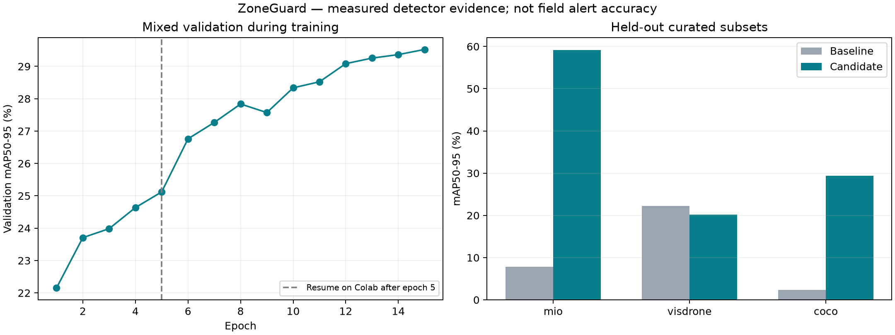

# Đánh giá mô hình

## Giao thức

Dataset compact gồm 12.000 ảnh train, 1.500 validation và 1.500 test từ MIO-TCD, VisDrone và COCO. Validation/test lấy 500 ảnh mỗi nguồn. Các số đo là kết quả trên split chọn lọc, không phải benchmark dataset đầy đủ.

Baseline và ứng viên được đo trên cùng Tesla T4. Quy tắc lựa chọn dùng validation: trung bình đều nguồn mAP50–95 phải cải thiện hơn 0,005, từng nguồn không giảm quá 0,02 và F1 trên video hồi quy không giảm. Quyết định được tính trước khi đánh giá test; không dùng test để chọn checkpoint.

Run hoàn thành 15 epoch (5 laptop và 10 Colab), chọn checkpoint epoch 15. Trung bình validation mAP50–95 tăng từ 12,18% lên 36,52%. Cấu hình và nguồn dữ liệu được lưu trong [run settings](../reports/compact-run-settings.json), [provenance](../reports/compact-dataset.json), [manifest](../data/compact-manifest.json.gz) và [quyết định chọn checkpoint](../reports/colab-checkpoint-selection.json).

## Kết quả test

| mAP50–95 | Baseline | Fine-tuned | Thay đổi (điểm %) |
|---|---:|---:|---:|
| MIO-TCD | 7,80% | 59,16% | +51,36 |
| VisDrone | 22,22% | 20,14% | −2,08 |
| COCO vehicles | 2,31% | 29,34% | +27,03 |
| Trung bình đều ba nguồn | 10,78% | 36,21% | +25,44 |

Trung bình đều nguồn là trung bình cộng của ba mAP, không phải mAP tính gộp tất cả ảnh. Mức giảm cho phép 0,02 áp dụng validation; kết quả test VisDrone vẫn giảm 2,08 điểm phần trăm.



[Báo cáo theo lớp và nguồn](../reports/compact-training.json) · [Baseline validation/test](../reports/colab-baseline-validation.json) · [Learning curve CSV](../reports/compact-training-curve.csv)

## Kiểm tra pipeline

Video bãi xe có 377 khung hình và hai lượt xe có nhãn trong [parking reference](../reports/parking-reference.json). F1 cảnh báo là 1,00 cho cả baseline và model fine-tuned; F1 có xét loại xe tăng từ 0,50 lên 1,00. Pipeline đầy đủ, tính xuất H.264, đạt lần lượt 27,93 và 28,10 FPS trên T4 trong một lần chạy.

Các số đo T4 ở trên thuộc pipeline trước khi bổ sung chính sách tổng hợp nhãn. Chính sách hiện tại có thể trả về nhóm chung khi các nhãn xung đột, thay vì luôn gán một loại xe cụ thể. Phép đo mới bên dưới sử dụng pipeline hiện tại; không so sánh FPS giữa hai máy như cùng một thí nghiệm.

[Video kết quả](../reports/demo-colab-model.mp4) · [Thông tin môi trường](../reports/colab-runtime.json)

## Precision/recall cảnh báo và cảnh báo sai mỗi giờ

Đo lại trên RTX 3060 Laptop, cùng checkpoint baseline/fine-tuned, cùng bản đồ `config/parking.json` và toàn bộ **30,16 giây = 377 khung / 12,5 FPS nguồn**. Nhãn gồm hai lượt xe; video đã dùng để hiệu chỉnh nên đây là kiểm tra hồi quy.

| Chế độ | Mô hình | TP | FP | FN | Precision | Recall | F1 | FP/giờ |
|---|---|---:|---:|---:|---:|---:|---:|---:|
| Không xét loại xe | Baseline | 2 | 0 | 0 | 100% | 100% | 1,00 | 0,00 |
| Không xét loại xe | Fine-tuned | 2 | 0 | 0 | 100% | 100% | 1,00 | 0,00 |
| Có xét loại xe | Baseline | 0 | 2 | 2 | 0% | 0% | 0,00 | 238,73 |
| Có xét loại xe | Fine-tuned | 2 | 0 | 0 | 100% | 100% | 1,00 | 0,00 |

- **TP:** cảnh báo ghép được với một lượt xe có nhãn, cùng vùng và nằm trong cửa sổ thời gian xác nhận. Xét cảnh báo theo thời gian, ưu tiên cửa sổ hợp lệ kết thúc sớm nhất khi chồng nhau. Mỗi lượt chỉ ghép một lần; cảnh báo trùng tính là FP.
- **FP:** cảnh báo không ghép được; **FN:** lượt vi phạm có nhãn bị bỏ sót.
- **Precision = TP / (TP + FP)**; **recall = TP / (TP + FN)**. Khi mẫu số bằng 0, công cụ quy ước trả 0 và vẫn giữ các số đếm để diễn giải.
- **Cảnh báo sai/giờ = FP × 3.600 / thời lượng video đã đánh giá**. Mẫu số là thời gian quan sát, không phải thời gian máy xử lý. Đây là tốc độ phát sinh lỗi, không phải tỷ lệ FPR dựa trên true negative.

`alert_only` không yêu cầu đúng loại xe: baseline vẫn bắt được cả hai lượt đi vào vùng. `class_aware` yêu cầu nhãn khớp: baseline trả một `unknown` và một `truck` cho hai ô tô, nên có hai FP và hai FN. FP/giờ có xét loại xe bao gồm lỗi nhãn, không đồng nghĩa có từng ấy cảnh báo vùng cấm giả. Ví dụ, một FP trong clip này đã tương đương 119,36 FP/giờ khi quy đổi.

**Không quan sát thấy FP trong 30,16 giây không chứng minh tốc độ báo sai dài hạn bằng 0.** Cần video có nhãn dài hơn, gồm cả đoạn không vi phạm và nhiều điều kiện camera, để đánh giá vận hành thực tế. Các cửa sổ thời gian hiện tại được gán thủ công và còn thô.

[Báo cáo mới](../reports/alert-evaluation.json) lưu cả hai chế độ, thời lượng, các lượt khớp/sai/bỏ sót, cấu hình, hash trọng số và mã pipeline. Báo cáo training cũ được giữ nguyên để phân biệt hai phiên bản pipeline.

### Chạy lại phép đánh giá

Từ thư mục dự án sau khi cài đặt:

```powershell
.\.venv\Scripts\python.exe pipeline.py data/samples/car-detection.mp4 --zones config/parking.json --model large --device auto --output .local/alert-eval-current
.\.venv\Scripts\python.exe scripts/evaluate_events.py reports/parking-reference.json .local/alert-eval-current/result.json --output .local/alert-eval-current/metrics.json
```

Dùng `--model vehicle` và thư mục output khác để đo baseline. Mỗi lần chạy cần thư mục output mới. Tham chiếu phải gán nhãn đủ toàn bộ video; thời lượng tính từ số khung/FPS với nguồn có tốc độ khung hình cố định. CLI kiểm hash video, bản đồ và quy tắc vùng, FPS hữu hạn dương, số khung đã xử lý và cửa sổ nhãn. Nó từ chối phiên dừng sớm, camera live hoặc clip chỉ chạy một phần; không dùng demo 18 giây trong README để suy ra số đo toàn video. Các lần training mới cũng ghi precision/recall và FP/giờ vào phần `admission_video`.

## Giới hạn diễn giải

- COCO/VisDrone từng được sử dụng trong phát triển model gốc; không gọi test hiện tại là độc lập hoàn toàn với lịch sử phát triển.
- Split MIO chưa chứng minh độc lập camera; loại ảnh trùng hệt không loại được mọi tương quan giữa camera và cảnh.
- Chưa có benchmark thực địa đủ lớn theo lượt xe, ban đêm, thời tiết hoặc camera triển khai.
- FPS phụ thuộc video, phần cứng và chi phí xuất kết quả; một lần chạy không phải phân phối hiệu năng.

Xem [model card](../models/MODEL_CARD.md) để biết checksum và giấy phép, [hướng dẫn Colab](COLAB.md) để tái tạo dữ liệu và chạy huấn luyện.
